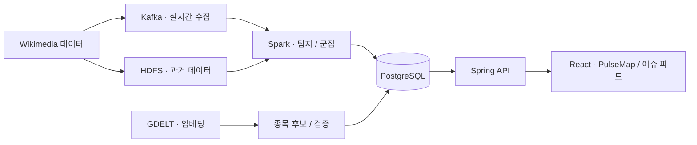

# WikiPulse · 위키펄스

**위키피디아의 편집·조회 변화에서 이슈를 찾고, 관련 미국 상장 종목과 연결해 탐색하는 데이터 서비스입니다.**

위키피디아의 활동 급증을 포착한 뒤 실제 화제성 이슈인지 검증하고, 문서 간 관계와 연관 종목을 이슈 피드와 PulseMap으로 제공합니다. 이슈 발견과 종목 매핑을 분리해 종목 정보가 탐지를 편향시키지 않도록 설계했습니다.

| 항목 | 내용 |
| --- | --- |
| 프로젝트 | SSAFY 15기 특화 프로젝트 · 빅데이터 분산처리 트랙 |
| 개발 기간 | 2026.08.11 ~ 2026.09.28 |
| 팀 구성 | 6명 |
| 담당 | 윤광혁 · 팀장 / 전체 기획·조율 / 프론트엔드 / 발표 |

## 주요 기능

- **이슈 탐지**: 편집 이벤트와 조회수 변화, 과거 기준선을 활용해 급증 신호를 포착합니다.
- **문서 관계 탐색**: 이슈와 문서 사이의 관계를 PulseMap에서 시각화하고 상세 내용을 확인합니다.
- **이슈 검증과 종목 매핑**: GDELT와 벡터 임베딩 기반 후보를 조합하고 관련성을 검증합니다.
- **시점별 탐색**: 스냅샷 시점을 기준으로 이슈·문서·종목 정보를 조회합니다.
- **계정·보관 기능**: 계정 API, 세션, 북마크 기능을 제공합니다. 프론트엔드의 mock 데이터 모드는 별도로 유지됩니다.

## 제가 맡은 일

| 영역 | 담당 내용 | 코드·문서 |
| --- | --- | --- |
| 기획·초기 검증 | 공개 데이터로 이슈 탐지가 가능한지 POC를 수행하고 실시간/배치 처리의 초기 구조를 설계 | [데이터 파이프라인](data-pipeline/), [기술 명세](docs/tech-spec-v0.3.md) |
| 데이터 계약 | 스냅샷 시점, 출처, 결측값, 관계 근거의 의미가 API와 화면에서 유지되도록 계약과 연동 구현 | [프론트엔드 API 결정](docs/frontend/API_DECISIONS.md), [데이터 소스](docs/frontend/DATA_SOURCE.md) |
| 프론트엔드 | PulseMap, 시점별 탐색, 이슈·종목 화면과 서비스 연동 구현 | [frontend/](frontend/), [PulseMap 문서](docs/frontend/PULSE_MAP.md) |
| 계정·DB | 계정 API·세션·북마크 및 기존 DB 업그레이드 구현 | [backend/](backend/), [db/](db/) |
| 종목 연결 | 벡터 임베딩과 GDELT를 병행하는 방식을 직접 제안하고 개발 | [종목 파이프라인](data-pipeline/stock/) |
| 팀 운영·발표 | 팀장으로 전체 기획과 기능별 역할 분담·작업 조율을 수행하고 실제 배포 서비스 기준 시연·발표 진행 | [요구사항의 팀 역할](docs/requirements-v0.3.md#8-팀) |

초기 분산 구조 설계와 서비스 구현을 맡았으며, Kafka·Spark·HDFS의 실제 구축과 운영 고도화 전체는 팀의 공동 결과입니다. 초기 POC는 별도 작업물로, 이 저장소에 초기 POC 전체가 포함되어 있다는 뜻은 아닙니다. 분산 실행을 성능 향상 수치로 제시하지 않습니다.

## 기술 구성

| 영역 | 기술 |
| --- | --- |
| Frontend | React 19, JavaScript, Vite, d3-force, Three.js |
| Backend | Java 17, Spring Boot, Spring Security, JPA |
| Pipeline | Python, Kafka, Spark Structured Streaming / Batch, HDFS |
| Data / Matching | PostgreSQL, pgvector, Wikimedia 데이터, GDELT, 임베딩·LLM 연계 |
| Infra | Docker Compose, nginx |



## 코드와 문서 둘러보기

- [frontend/](frontend/) · [프론트엔드 아키텍처](docs/frontend/ARCHITECTURE.md)
- [backend/](backend/) · [API 명세](docs/api-v0.3.md)
- [data-pipeline/](data-pipeline/): 수집·배치·탐지·군집·종목 처리
- [db/](db/): 스키마·마이그레이션·데이터 계약 검증
- [ai/](ai/): 매칭·검증 실험
- [검증 기록](docs/validation/INDEX.md)

## 프론트엔드 빠르게 실행하기

백엔드 없이 mock 데이터로 화면을 확인할 수 있습니다.

```bash
cd frontend
cp .env.example .env.local
npm ci
npm run dev
```

`VITE_DATA_SOURCE=mock`으로 실행하면 `http://127.0.0.1:5174`에서 확인할 수 있습니다. 실제 데이터 연동은 API 모드와 Spring·DB·파이프라인 환경이 필요합니다. 상세 절차는 [프론트엔드 실행 문서](frontend/README.md)와 [백엔드 실행 문서](backend/README.md)를 참고하세요. 기존 문서의 초기 상태 설명과 현재 구현에 차이가 있을 때는 코드와 계약을 함께 확인하세요.

## 저장소 안내

이 저장소는 팀 프로젝트의 **공개 포트폴리오용 소스 스냅샷**입니다. 원본 커밋 `62e5313`을 기준으로 코드와 기술 문서를 옮겼으며, 과거 Git 이력·개인 설정·로그와 작업 산출물은 제외했습니다. 환경 예시의 인증값은 비워 두고 운영 호스트 IP는 예시 주소로 치환했습니다. 팀의 기존 안내 문서는 [TEAM_README.md](TEAM_README.md)에 보존했습니다.
